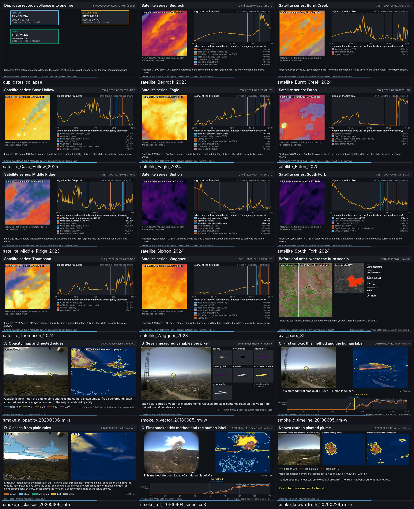

# Clips

All clips 1920x1080 H.264. Each was decoded from first to last frame with ffmpeg (no errors) and its duration checked (20 to 40 s). **Selection note:** the sequence clips use sealed sequences chosen by eye, after the sealed run, because a plume is visible in them (20160604 smer-tcs3, 20180605 rm-w, 20200306 ml-s). They do not represent typical behaviour: on many other sealed sequences the smoke class also paints sun-lit ground, shadows or cloud edges (see results/SMOKE_RESULTS.md, S2 and the false-alarm list). The ten satellite clips show the ten fires of the live track's final export (live_export_v0.1; detection times are the live track's final values); the scar clip shows six of the 30 final S1 scar pairs of track caught (the six with the largest accepted scar area, chosen so the outline is visible) and the duplicate clip six of the 12 collapse examples of track records. Credit burnt into every frame: HPWREN, http://hpwren.ucsd.edu/ (sequence clips); Copernicus Sentinel-2 (scar clip); NOAA GOES-R (satellite clip); FPA FOD, ICS-209-PLUS, MTBS (duplicates clip).

| file | frames | seconds | size | decodes start to end | MB |
|---|---|---|---|---|---|
| duplicates_collapse.mp4 | 720 | 24.0 | 1920x1080 | yes | 0.5 |
| satellite_Bedrock_2023.mp4 | 720 | 24.0 | 1920x1080 | yes | 1.3 |
| satellite_Burnt_Creek_2024.mp4 | 720 | 24.0 | 1920x1080 | yes | 1.3 |
| satellite_Cave_Hollow_2025.mp4 | 720 | 24.0 | 1920x1080 | yes | 1.2 |
| satellite_Eagle_2024.mp4 | 720 | 24.0 | 1920x1080 | yes | 1.2 |
| satellite_Eaton_2025.mp4 | 720 | 24.0 | 1920x1080 | yes | 1.1 |
| satellite_Middle_Ridge_2023.mp4 | 720 | 24.0 | 1920x1080 | yes | 1.5 |
| satellite_Siphon_2024.mp4 | 720 | 24.0 | 1920x1080 | yes | 1.1 |
| satellite_South_Fork_2024.mp4 | 720 | 24.0 | 1920x1080 | yes | 1.1 |
| satellite_Thompson_2024.mp4 | 720 | 24.0 | 1920x1080 | yes | 1.3 |
| satellite_Waggner_2023.mp4 | 720 | 24.0 | 1920x1080 | yes | 1.0 |
| scar_pairs_S1.mp4 | 720 | 24.0 | 1920x1080 | yes | 2.1 |
| smoke_a_opacity_20200306_ml-s.mp4 | 720 | 24.0 | 1920x1080 | yes | 2.4 |
| smoke_b_vector_20180605_rm-w.mp4 | 720 | 24.0 | 1920x1080 | yes | 1.3 |
| smoke_c_timeline_20180605_rm-w.mp4 | 720 | 24.0 | 1920x1080 | yes | 1.6 |
| smoke_d_classes_20200306_ml-s.mp4 | 720 | 24.0 | 1920x1080 | yes | 1.7 |
| smoke_full_20160604_smer-tcs3.mp4 | 1005 | 33.5 | 1920x1080 | yes | 4.5 |
| smoke_known_truth_20200226_rm-e.mp4 | 720 | 24.0 | 1920x1080 | yes | 0.5 |

